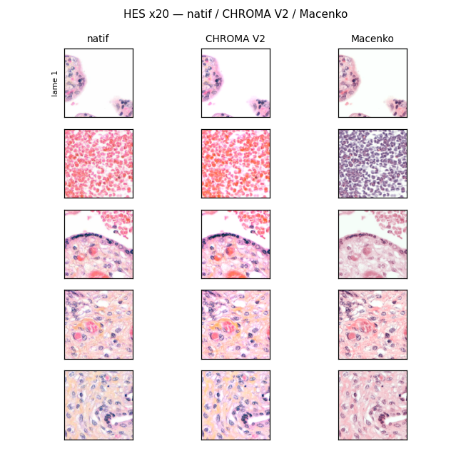

***English** | [Français](README.fr.md)*

# CHROMA V2

**C**alibrated **H**istological **R**econstruction **O**f **M**ultiplexed **A**bsorbances

A stain normalizer for **HES** slides (Hematoxylin–Eosin–Saffron) that works in
**optical density** and separates brightness from chromaticity **before** decomposition.
Single file, `numpy` + `scikit-learn`, no deep learning.



*Placenta patches at x20. Left column: native image (inter-slide staining variability).
Middle: CHROMA V2. Right: Macenko. CHROMA harmonizes color while staying close to the
native image (DINOv2 cosine distance ≈ 0.02–0.03 vs native, against ≈ 0.05–0.09 for Macenko
on the same patches) and preserves the pigments and red blood cells that Macenko erases.*

## Why

HES staining varies from slide to slide (reagents, bath age, scanner). This color drift
disturbs both the pathologist's eye and encoders (DINOv2, CTransPath…). Existing normalizers
each have a weakness:

| Method | Limitation |
|---|---|
| **Macenko** (SVD, 2 components H&E) | Ignores saffron, unstable per slide, destroys pigments (meconium, hemosiderin) and red blood cells |
| **Reinhard** (Lab) | Separates brightness/chromaticity but in a **perceptual** space, not a physical one |

**CHROMA** is the synthesis: OD space (physical, additive via Beer-Lambert) + brightness/
chromaticity separation (Reinhard's idea) + a biological 3-stain decomposition.

### The physical principle

The 3 HES stains behave like the 3 subtractive **CMYK** primaries: H ≈ Cyan, E ≈ Magenta,
S ≈ Yellow, plus a residual = Key (pigments). Moving to optical density makes the mixture
**additive**:

```
OD = -log10(I / I0)          (Beer-Lambert law, I0 = bright background per slide)
```

### The V2 novelty: remove the gray axis before decomposing

The gray axis `ĝ = [1,1,1]/√3` in OD encodes **thickness/brightness variation** without color.
In V1 it contaminated the saffron channel (saffron would "light up" on gray tissue). V2 removes
it **before** decomposition:

```
T   (brightness)     = OD · ĝ                  tissue thickness, scalar per pixel
Sat (saturation)     = ‖OD − T·ĝ‖              chromatic intensity
c   (concentrations) = pinv(S⊥) · (OD − T·ĝ), clamped ≥ 0   on chromaticity only
K   (residual)       = OD − (T·ĝ + S⊥·c)       unexplained pigments
```

where `S⊥ = S − ĝ(ĝᵀS)` is the stain matrix projected out of the gray axis. Result: brightness
is carried by `T`, never by the stains → saffron no longer captures gray.

### 7 interpretable channels

```
RGB → OD ─┬─ T   [tissue thickness]
          ├─ Sat [chromatic intensity]
          └─ chromaticity ─ decomposition ─┬─ H [hematoxylin / nuclei]
                                           ├─ E [eosin / cytoplasm]
                                           ├─ S [saffron / collagen]
                                           └─ K [residual: meconium, hemosiderin, formalin]

Total: H, E, S, K, T, Sat + normalized image
```

The **K channel is left untouched** during normalization: this is the key advantage over
Macenko, which wipes out these diagnostic pigments. The gray-decontaminated **H channel**
isolates pure basophilia and turns out to be a strong descriptor of necrosis and inflammation.

## Automatic calibration

No annotation, no human intervention. We pool tissue pixels (Otsu mask on saturation) from
~10 HES slides, run a 3-component NMF **anchored** on a canonical HES basis (otherwise NMF is
non-identifiable on the HES cone), and assign H/E/S by dominant absorption channel. A single
site-specific artifact: a JSON calibration file.

## Usage

```python
import numpy as np
from PIL import Image
import chroma

# 1) calibrate a TARGET on ~10 RGB thumbnails of HES slides (once per site/scanner)
target = chroma.auto_calibrate([np.asarray(Image.open(p).convert("RGB")) for p in thumbs])
norm = chroma.CHROMA(target)

# 2) for each slide to normalize: calibrate its SOURCE and build the PIL→PIL function
src = chroma.auto_calibrate([np.asarray(Image.open("slide.png").convert("RGB"))])
stain_fn = chroma.make_stain_fn(src, norm)

normalized = stain_fn(Image.open("patch.png"))     # normalized RGB PIL.Image

# 3) decomposition into 7 channels (2D maps)
channels = norm.decompose(np.asarray(Image.open("patch.png").convert("RGB")))
H, E, S, K, T, Sat = (channels[k] for k in ("H", "E", "S", "K", "T", "Sat"))
```

`stain_fn` plugs directly in as a `torchvision.transforms.Lambda` in an embedding pipeline.
Cost < 1 s per 224×224 patch on CPU.

Built-in self-check:

```bash
python chroma.py     # gray decontamination, reconstruction ≈ identity, gains OK
```

## Calibration format (JSON)

```json
{
  "method": "NMF_auto_chroma_separated",
  "chroma_version": "2.0",
  "I0": [253.7, 253.6, 253.7],
  "stain_vectors": { "H": [...], "E": [...], "S": [...] },
  "stats": {
    "mu": [...], "sigma": [...],
    "brightness_mu": 0.092, "brightness_sigma": 0.05,
    "sat_mu": 0.053, "sat_sigma": 0.03
  },
  "calib_id": "4d75cb66"
}
```

## Dependencies

`numpy`, `scikit-learn`, `opencv-python`, `Pillow` (see `requirements.txt`). No framework,
no ORM, no GPU required.

## Authors

- **Rémi Mathevet** — fetal pathologist — design, specification, clinical validation
- **Claude** (Anthropic) — implementation, gray-separated decomposition, QC tooling

## License

Apache-2.0
